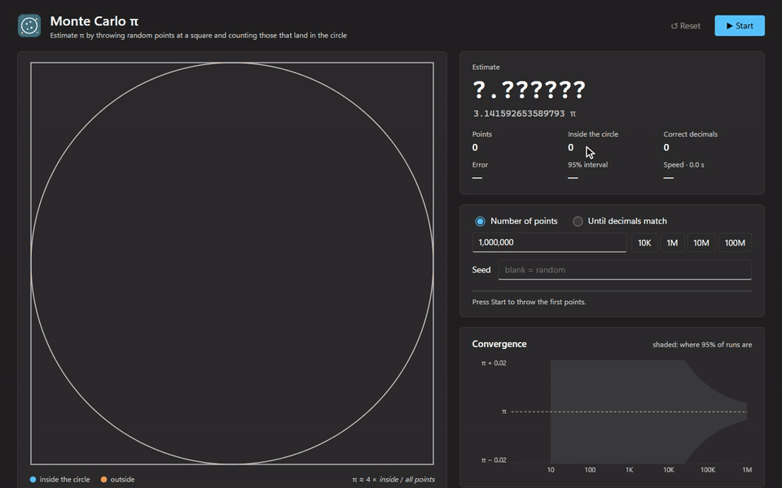
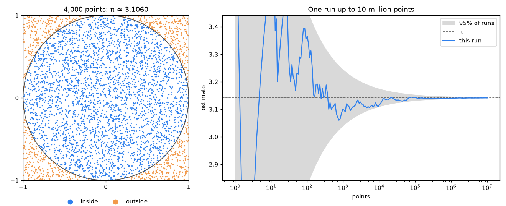
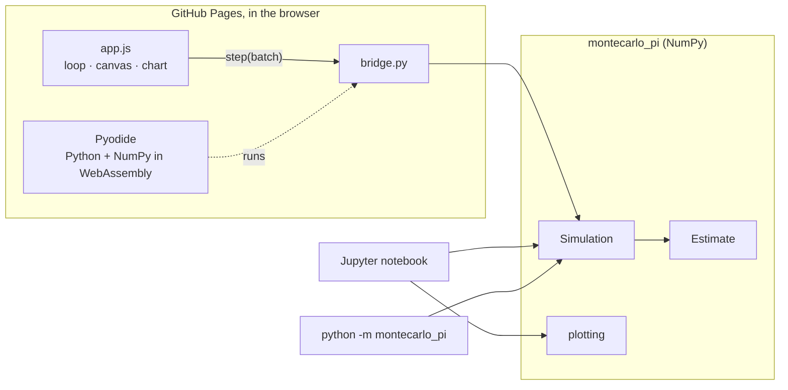
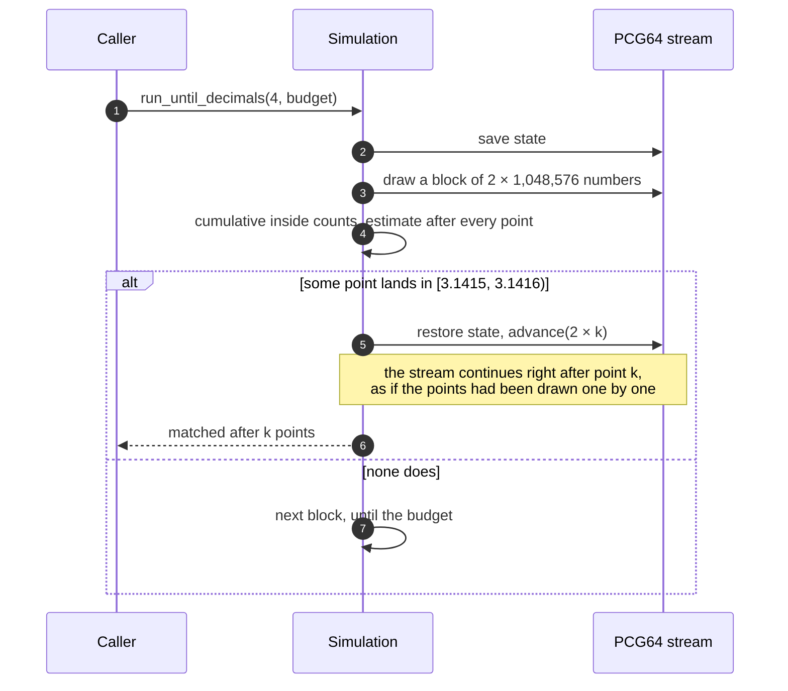

<div align="center">

# 🎯 Monte Carlo π · Python

[](https://github.com/pero-grubac/Monte-Carlo-based-Pi-Calculator-py/actions/workflows/ci.yml)
[](https://github.com/pero-grubac/Monte-Carlo-based-Pi-Calculator-py/actions/workflows/pages.yml)


**Estimate π by throwing random points at a square. One NumPy package, used three ways: in the browser, in a Jupyter notebook and on the command line.**

### [▶ Try it in the browser](https://pero-grubac.github.io/Monte-Carlo-based-Pi-Calculator-py/)



</div>

---

## 📌 Project Overview

A circle of radius 1 inside the square [−1, 1]² covers π/4 of it. Throw points at the square uniformly at random, and the share that lands inside the circle approaches π/4:

```
π ≈ 4 × (points inside the circle) / (all points)
```

The `montecarlo_pi` package does this with NumPy, in blocks of a million points at a time, and reports how precise the result is. The same package runs in three places:

| Where | What you get | Start with |
|-------|--------------|------------|
| 🌐 **Browser** | Live square, green correct digits, convergence chart. Real Python and NumPy, running locally via Pyodide. | [Open the page](https://pero-grubac.github.io/Monte-Carlo-based-Pi-Calculator-py/) |
| 📓 **Notebook** | The idea step by step: one run, convergence, points needed per decimal, a thousand runs against the normal curve | [`notebooks/monte_carlo_pi.ipynb`](notebooks/monte_carlo_pi.ipynb) |
| 💻 **Command line** | One estimate with error, interval and speed | `python -m montecarlo_pi 1e8` |

---

## ✨ Features

- ⚡ **Vectorised**: about 45 million points per second with NumPy on one core, and about 28 million in the browser
- 🔁 **Reproducible**: a seed repeats a run exactly, however it is split into calls. The browser, the notebook and the command line all agree.
- 🎯 **Until decimals match**: stops at *exactly* the first point where the estimate's decimals equal π's, found with a cumulative sum over each block and a rewind of the random stream
- 📊 **Honest statistics**: standard error, 95% interval, correct decimals, and the points you would need for real certainty
- 🌐 **No server**: the page is static on GitHub Pages and computes everything in the browser. Light and dark mode, and it works on a phone.
- 📓 **A notebook that tells the story**, executed in CI so it never breaks
- ✅ **Tested and linted**: pytest and ruff on Python 3.11 and 3.13

### 🧮 How precise is it?

Each point lands inside with probability p = π/4, so the estimate's standard deviation is `√(π(4 − π)) / √N ≈ 1.642 / √N`. Every extra correct decimal costs **100 times more points**:

| Decimals (95% sure) | Points needed | With NumPy (~45 M/s) |
|--------------------:|--------------:|---------------------:|
| 2 | 4.1 × 10⁵ | 0.01 seconds |
| 3 | 4.1 × 10⁷ | 0.9 seconds |
| 4 | 4.1 × 10⁹ | 1.5 minutes |
| 5 | 4.1 × 10¹¹ | 2.6 hours |
| 6 | 4.1 × 10¹³ | 10.7 days |
| 7 | 4.1 × 10¹⁵ | 2.9 years |

*Until decimals match* usually stops far sooner, because a random estimate wanders through the right window by chance. With seed 19, four decimals match after only 1,477 points (3.14150305), which is luck, not precision.

<p align="center"></p>

---

## 🛠️ Tech Stack

| Technology | Usage |
|------------|-------|
| Python 3.11+ | The package, the command line and the notebook |
| NumPy (PCG64) | Vectorised sampling, seedable and rewindable random stream |
| Matplotlib + Jupyter | Figures and the notebook |
| Pyodide 0.28 | Python and NumPy compiled to WebAssembly, in the browser |
| HTML, CSS, JavaScript | The page: canvas drawing, layout, the run loop |
| pytest + ruff | Tests, lint and formatting |
| GitHub Actions + Pages | CI on two Python versions, notebook execution, deploying the page |

---

## 📁 Repository Structure

```
Monte-Carlo-based-Pi-Calculator-py/
├── montecarlo_pi/                 The package
│   ├── estimate.py                Estimate, statistics, decimal windows, points needed
│   ├── simulation.py              Simulation: run(n), run_until_decimals(d), convergence()
│   ├── plotting.py                Matplotlib figures (notebook only)
│   └── __main__.py                Command line
├── notebooks/monte_carlo_pi.ipynb The explained walk-through, with outputs
├── web/                           The browser version
│   ├── index.html · style.css
│   ├── app.js                     Loads Pyodide, runs the loop, draws
│   └── bridge.py                  Calls into montecarlo_pi from JavaScript
├── tests/                         pytest
├── pyproject.toml                 Package, extras, pytest and ruff settings
└── .github/workflows/             ci.yml, pages.yml
```

---

## 🚀 Installation

**Prerequisites:** Python 3.11 or newer.

```bash
git clone https://github.com/pero-grubac/Monte-Carlo-based-Pi-Calculator-py.git
cd Monte-Carlo-based-Pi-Calculator-py
python -m venv .venv
.venv\Scripts\activate          # Windows
source .venv/bin/activate       # macOS, Linux
pip install -e ".[notebook,dev]"
```

The extras are optional: `notebook` adds Matplotlib and JupyterLab, `dev` adds pytest and ruff. The package itself only needs NumPy.

### Tests and lint

```bash
pytest
ruff check . && ruff format --check .
```

---

## 🧭 Usage

### In the browser

Open the [page](https://pero-grubac.github.io/Monte-Carlo-based-Pi-Calculator-py/). The first visit downloads Python and NumPy (about 10 MB, cached afterwards). Pick *Number of points* or *Until decimals match*, optionally a seed, and press **Start** (`Ctrl+Enter`).

To run the page locally, serve the repository root and open `/web/`:

```bash
python -m http.server 5173
# http://localhost:5173/web/
```

### In Python

```python
from montecarlo_pi import Simulation, estimate_pi

e = estimate_pi(10_000_000, seed=42)
print(e.pi, e.error, e.interval95, e.matching_decimals)

simulation = Simulation(seed=19)
matched, points = simulation.run_until_decimals(4, budget=10**9, capture=1000)
print(simulation.estimate.total)  # 1477
```

### On the command line

```bash
python -m montecarlo_pi 1e8 --seed 1
python -m montecarlo_pi --decimals 4 --seed 19
```

```
estimate   3.1415936800   (5 correct decimals, done)
π          3.141592653589793
error      +1.03e-06   95% interval [3.141272, 3.141916]
points     100,000,000 (78,539,842 inside) in 2.26 s (44,199,821 points/s)
seed       1
```

### The notebook

```bash
jupyter lab notebooks/monte_carlo_pi.ipynb
```

---

## ☁️ Deployment

The page is published by [`pages.yml`](.github/workflows/pages.yml) whenever `web/` or the package changes on `master`. The workflow copies `web/` and the three package files the page needs into one folder and deploys it to GitHub Pages.

One-time setup: **Settings → Pages → Build and deployment → Source: GitHub Actions**.

---

## 🏗️ Architecture



### Stopping exactly when the decimals match



---

## 🧭 Design Decisions

- **One package, three front ends.** The browser page does not reimplement the maths in JavaScript. It loads the same `.py` files into Pyodide, so a seed gives the same answer everywhere.
- **Blocks, not loops.** The first version drew one point at a time with `np.random.uniform` and appended tuples to a list. Generating a million points as one array is close to 200 times faster (0.40 s against 2 ms per 100,000 points) and keeps memory flat.
- **Exact stops without losing reproducibility.** A block may overshoot the matching point. The PCG64 state is saved before each block and advanced past exactly the points used, so a later `run()` continues as if nothing had been overshot.
- **The full circle in [−1, 1]².** The first version also used `√(x² + y²) < 1`. The square root is unnecessary: `x² + y² ≤ 1` is the same test.
- **The page is static.** No server, no build step: three files plus the package, deployed by a short workflow. A Streamlit app would need a server that sleeps when idle.
- **Small, fast batches first.** The page grows its batches from 25 points per frame, so the first points can be watched as they land, then sizes them from the measured speed to keep the page responsive.
- **CI only when it matters.** Tests skip changes to docs and `web/`, and the page only redeploys when `web/` or the package changes.

---

## 📄 License

[MIT](LICENSE.txt) © 2025 Pero Grubač
